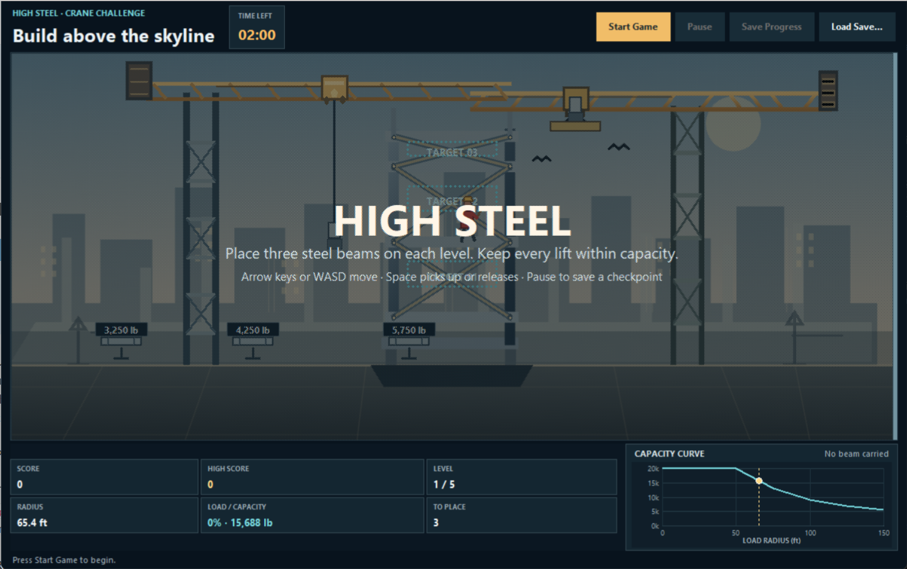
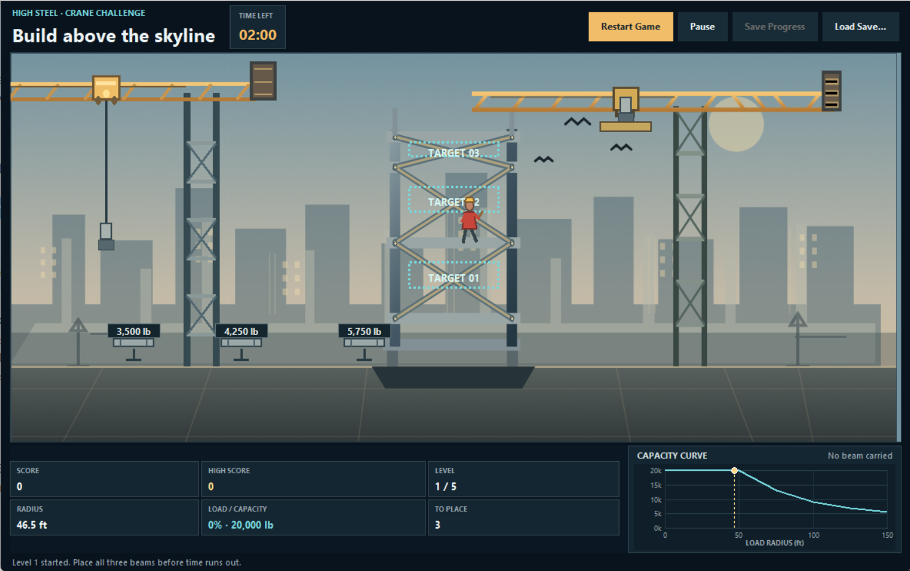
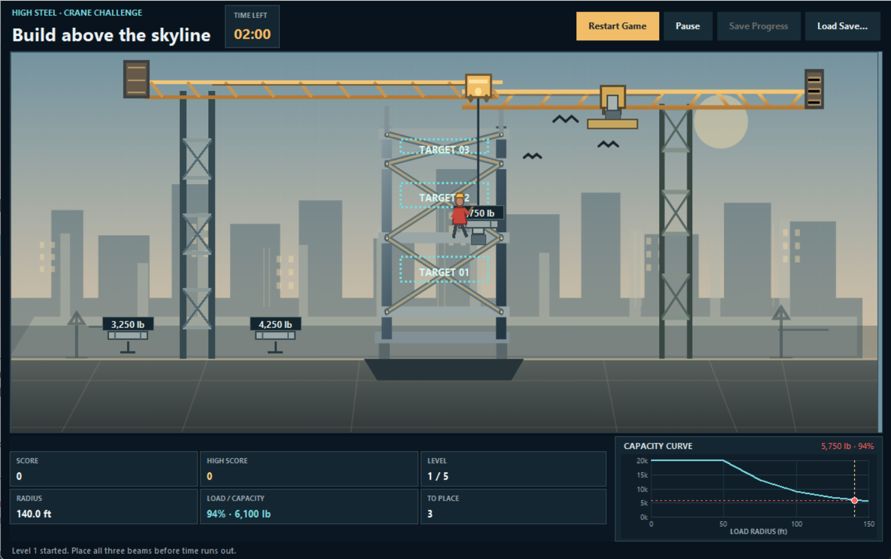

# High Steel

## Description

High Steel is a crane game about lifting steel beams into an unfinished tower. Move the trolley and hook, pick up beams, and place all three targets before the level timer runs out. The project has an original browser version in `index.html` and a native Python Tkinter desktop version with the same construction-site artwork.

## Screenshots

**Starting scene**



**Crane facing left**



**Carried beam and live capacity graph**



## How to run

Install Python 3.10 or later with Tkinter, open a terminal in the project folder, and start the desktop app:

```sh
python app.py
```

To open the browser version instead:

```sh
python web.py
```

The web command starts a local server and opens `index.html` in your browser. Press Ctrl+C in the terminal to stop it. You can also open `index.html` directly or use GitHub Pages. The game itself has no third-party Python package requirements.

## Controls

| Control | Action |
|---|---|
| Left / Right arrow or A / D | Move the trolley along the boom; continue toward the other side at the mast to turn the crane. |
| Up / Down arrow or W / S | Raise or lower the hook. |
| Space | Pick up, release, or place a beam over an open target. |
| Pause / Resume button | Freeze or resume the game. |
| Save Progress button | Save a JSON checkpoint while paused. |
| Load Save button | Open a saved checkpoint. |

## Features

- Five timed levels with three beam placements per level, scoring, and a local high score.
- A capacity limit that changes with trolley radius, a 90% warning, and an overload failure at the limit.
- A worker, an automatic crane, and birds that can disturb the cable and carried beam.
- A live graph showing load radius, crane capacity, and the carried beam's weight.
- Portable JSON checkpoints for paused desktop games. The save records level progress, time, score, and placed beams; the high score remains local to each computer.

## Validation

The [Desktop App Validation Results](spec.md#desktop-app-validation-results) table records expected and actual values for each desktop implementation step. Its first three items link to the [Step 1](03_output/capacity-validation-step-1.svg), [Step 2](03_output/capacity-validation-step-2.svg), and [Step 3](03_output/capacity-validation-step-3.svg) capacity graphs.

The latest recorded checks passed 10 numerical cases, 315 beam routes, 32 property samples (including proportionality and symmetry), 17 source checks, 16 Python unit tests, and 9 Tkinter acceptance tests. A physical checkpoint transfer to a second computer remains to be checked.

To rerun the checks, use the following commands from the project folder. Node.js is needed only for the independent reference validator:

```sh
node 02_validation/validate_desktop.js 3
python -m unittest discover -s 02_validation
python 02_validation/gui_checks.py
```

## Development workflow

The existing Git history records the implementation steps in [`spec.md`](spec.md). These commits match the six web steps and three desktop steps:

| Workflow step | Commit | Work completed |
|---|---|---|
| Web 1 | `a9677c8` | Build the construction scene and layout. |
| Web 2 | `cfeaf35` | Add crane movement and beam controls. |
| Web 3 | `64f9057` | Add capacity calculations and beam generation. |
| Web 4 | `20646fa` | Add target placement, timers, scoring, and level progression. |
| Web 5 | `6044a8a` | Add worker, automatic crane, and bird hazards. |
| Web 6 | `ae87f69` | Add high score and finish the presentation. |
| Desktop 1 | `71e5788` | Build the native scene and capacity graph. |
| Desktop 2 | `de26b66` | Port gameplay and desktop features. |
| Desktop 3 | `678ec90` | Complete the final review and acceptance checks. |

## Project layout

| Path | Purpose |
|---|---|
| `index.html` | Original single-file web app and GitHub Pages entry point. |
| `app.py` / `web.py` | Desktop and web launch commands. |
| `04_desktop/` | Tkinter game code and scene assets. |
| `02_validation/` | Reference validator and Python checks. |
| `03_output/` | Screenshots and capacity-validation graphs. |
| `00_planning/` / `01_data/` | Planning notes and data files. |
| `spec.md` / `prompts.md` | Project specification, validation results, and request log. |
