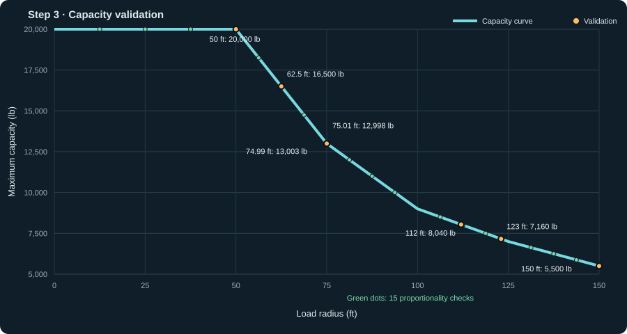

## Purpose
A crane operation game where the player uses the left tower crane to place three steel pieces in their highlighted target locations on each of five increasingly difficult levels. Each level changes the tower layout and tightens the target spaces. The time limits are 2:00, 1:30, 1:00, 0:45, and 0:30. The player must manage the load's changing capacity as the crane reaches farther out. This is a simple game inspired by crane load charts, not a tool for real-world crane operation.
## Inputs

Use either the arrow keys or WASD. Left and right move the trolley along the player's crane boom; up and down raise and lower the hook. When the trolley reaches the mast center, continuing to press toward the other side slowly turns the player crane around the mast so the trolley can reach the opposite side. The trolley cannot travel past the boom's ends, and the hook can move from boom height to ground level. The crane and trolley move at a steady, moderate speed. Press Space to pick up a beam when the hook is close enough, or release a carried beam. Only one beam can be carried at a time. When the carried beam is over an unfilled highlighted target, pressing Space places it there automatically. Use the upper-left Pause button to freeze the game; press Resume to continue. Pausing freezes the timer, cranes, worker, birds, and load sway. The player cannot steady a swaying load.
## Calculations

### Crane capacity by load radius

Measure the horizontal distance from the crane's center of rotation to the trolley. Let `r` be the radius in feet and `C(r)` the maximum permitted beam weight in pounds. In the game scene, 500 horizontal scene units represent the full 150 ft boom reach: `r = min(150, |x_trolley - x_mast| * 150 / 500)`. Cable and hook sway do not change the load radius.

| Load radius | Maximum beam weight |
|---:|---:|
| 0–50 ft | 20,000 lb |
| 50 ft | 20,000 lb |
| 75 ft | 13,000 lb |
| 100 ft | 9,000 lb |
| 125 ft | 7,000 lb |
| 150 ft | 5,500 lb |

Capacity is constant at 20,000 lb from 0 through 50 ft. Between each pair of chart distances, calculate capacity with linear interpolation:

```text
C(r) = C1 + ((r - r1) / (r2 - r1)) * (C2 - C1)
```

Here `(r1, C1)` and `(r2, C2)` are the chart points immediately below and above the current radius. For example, at 112 ft:

```text
C(112) = 9,000 + ((112 - 100) / (125 - 100)) * (7,000 - 9,000)
       = 8,040 lb
```

Update radius and capacity continuously as the trolley moves. Display the interpolated maximum capacity in pounds and the beam's capacity percentage. Only the beam's weight counts; the cable's weight is excluded.
### Capacity percentage and warning

Let `W` be the beam�s weight in pounds. Calculate the capacity percentage at the current radius as:

```text
P(r) = (W / C(r)) * 100%
```

Show a warning when:

```text
P(r) >= 90%
```

If the beam reaches or exceeds 100% capacity:

```text
P(r) >= 100%
```

If the player exceeds the load limit or the level timer expires, the player crane falls into the unfinished tower, then its boom and mast sections detach. The tower's columns, crossbeams, and braces also detach and fall as separate steel members. The red-clothed worker falls from the tower and bounces on the ground during either failure scene. After an overload, show a Level Failed screen with a Restart Level button. After a timeout, show a Level Failed screen with a Restart Game button that returns to level 1 and resets the score to zero.

### Beam generation and route feasibility

At the start of each level, generate three beams, each with a weight `W_i`, a pickup radius `r_p,i`, and a target radius `r_t,i`, where `i` is 1, 2, or 3. Spawn one beam well to the left of the tower and the other two to the right. Keep the challenge beam on the right so the player can carry it to the full 150 ft radius. Randomize pickup positions within the left and right boom areas while keeping all three positions reachable.

For each beam, check capacity at pickup and continuously along the trolley�s route to its target. Let `R_i` be the set of radii the beam passes through while being carried. The beam is feasible only if:

```text
W_i / C(r) < 1 for every r in R_i
```

Equivalently:

```text
W_i < min(C(r) for r in R_i)
```

Make each beam heavier on every successive level. For beam 1, use `3,250 + 500 * (level - 1)` lb plus a random 0 or 250 lb; for beam 2, use `4,250 + 500 * (level - 1)` lb plus a random 0 or 250 lb. The right-side challenge beam weighs `5,750 + 250 * (level - 1)` lb. Keep every generated weight below the minimum capacity along its pickup-to-target route. This preserves safe placement while making the later levels progressively harder and leaving the challenge beam above the crane's 150 ft capacity.
## Outputs

Display these outputs in separate, compact boxes along the bottom of the scene over the ground beneath the cranes and tower:

- **Timer:** Time remaining in the current level's limit: 2:00, 1:30, 1:00, 0:45, or 0:30 depending on the level.
- **Score:** Player’s current score.
- **High score:** Highest score achieved, saved locally in the current browser and retained between visits.
- **Level:** Current level out of five.
- **Radius:** Current load radius in feet.
- **Capacity:** Show the carried beam's weight as a percentage of the crane's interpolated capacity, along with the current maximum capacity in pounds.
- **Beam weights:** Show each beam’s weight on or next to that individual beam.
## Level progression and scoring

Show a start screen and begin the first level only after the player clicks Start Game. Set level time limits to 2:00, 1:30, 1:00, 0:45, and 0:30. Placing all three beams completes the level and starts the next one, with a total of five levels. Increase beam weights at every level, change the tower's bay spacing and target positions, and make the target openings narrower each level. If time reaches zero before all three beams are placed, play the crane and tower collapse scene, make the worker fall and bounce on the ground, then show a Level Failed screen with a Restart Game button. Restarting after a timeout returns to level 1 and resets the score to zero. Completing level five ends the game with a completion screen.

Award 100 points for each beam placed and a 200-point bonus for completing a level. Keep the score across levels and display the current level and number of beams remaining.

Whenever the current score exceeds the saved high score, store the new record in browser local storage and briefly highlight the high-score box. Flash the timer box during the final 10 seconds of a level.

If the player's hook or carried beam hits the walking worker or the automatic crane's moving beam, subtract 10 points and briefly show a large red “-10” on screen. These collisions do not stop the level. The score may drop below zero.
## Look and feel

Show the game in a 2D side view. The ground runs along the bottom of the screen, with a city skyline in the background. Place the unfinished steel tower in the middle, with one tower crane on each side. Change the tower's bay spacing, target positions, and target widths on each level while keeping the tower within the cranes' reach.

The player operates the crane on the left. It has a long boom, a box-shaped trolley that moves along the boom, and a cable hanging from the trolley. Show three empty spaces between the tower’s steel beams as the beam placement targets.

The crane on the right is also in the foreground and clearly visible. It moves automatically, continuously placing its own beams. Those beams can sometimes get in the way of the player’s crane as the player places beams.

Use realistic graphics and colors with a medium level of detail. Show a worker wearing red clothing and a hardhat, carrying a hammer, as he walks on the unfinished tower. If the player's hook or beam hits the worker or the automatic crane's moving beam, subtract 10 points and show a large red “-10” popup without stopping the level. The worker falls from the tower and bounces on the ground when the crane overloads or time expires.

Show black 2D birds flying across the sky at varying altitudes. When a bird hits the cable, make the cable and hook sway strongly whether or not a beam is attached; an attached beam sways with them.

When capacity reaches 90%, make the capacity percentage box flash red. Make the timer box flash red during the final 10 seconds of a level and briefly highlight the high-score box when a new record is set.
## Validation

- 50 ft: capacity is 20,000 lb.
- 62.5 ft: halfway between 50 ft (20,000 lb) and 75 ft (13,000 lb), so capacity is 16,500 lb.
- 74.99 ft: interpolate between 50 ft and 75 ft, giving approximately 13,003 lb.
- 75.01 ft: interpolate between 75 ft and 100 ft, giving approximately 12,998 lb.
- 112 ft: interpolate between 100 ft and 125 ft, giving 8,040 lb; the 90% warning threshold is 7,236 lb.
- 150 ft: capacity is 5,500 lb. A 5,750 lb challenge beam exceeds capacity at 150 ft, but remains below the approximately 7,160 lb route capacity at a 123 ft target radius.

## Desktop App Validation Results

- **Step 1 graph file:** [capacity-validation-step-1.svg](03_output/capacity-validation-step-1.svg)
- **Step 2 graph file:** [capacity-validation-step-2.svg](03_output/capacity-validation-step-2.svg)
- **Step 3 graph file:** [capacity-validation-step-3.svg](03_output/capacity-validation-step-3.svg)

All recorded desktop validation results are in this table. The capacity, route, and property values were checked by the independent JavaScript reference validator in `02_validation/validate_desktop.js`; Python unit tests and hidden-window Tkinter checks were also run with Python 3.15.2. Source checks inspect the Python code and scene assets. A separate physical computer was unavailable for a literal cross-computer save transfer.

| Step | Validation check | Expected | Actual | Status |
|:---:|---|---|---|---|
| **Step 1** | **Desktop shell, artwork, and capacity curve** | | | |
| 1 | Capacity at 50 ft | 20,000 lb | 20,000 lb | Pass, reference |
| 1 | Capacity at 62.5 ft | 16,500 lb | 16,500 lb | Pass, reference |
| 1 | Capacity at 74.99 ft | About 13,003 lb | 13,002.8 lb | Pass, reference |
| 1 | Capacity at 75.01 ft | About 12,998 lb | 12,998.4 lb | Pass, reference |
| 1 | Capacity at 112 ft | 8,040 lb | 8,040 lb | Pass, reference |
| 1 | 90% warning threshold at 112 ft | 7,236 lb | 7,236 lb | Pass, reference |
| 1 | Capacity at 123 ft | 7,160 lb | 7,160 lb | Pass, reference |
| 1 | Capacity at 150 ft | 5,500 lb | 5,500 lb | Pass, reference |
| 1 | Scaled scene images | 25 images at expected dimensions | 25 dimensions matched | Pass, asset check |
| 1 | Original SVG overlay coordinates | 38.1, 74.5, 56.2, 92.4 px | Coordinates applied in Tkinter drawing | Pass, source comparison |
| 1 | Interpolation proportionality | 15 samples match straight-line values; 87.5 ft gives 11,000 lb | 15 matched; 87.5 ft gives 11,000 lb | Pass, property |
| 1 | Left/right trolley symmetry | 4 pairs match; x = 10 and 610 give 90 ft and 10,600 lb | 4 matched; example matches | Pass, property |
| 1 | Python and Tkinter scene checks | Run desktop code and inspect full scene | 16 unit tests and 9 Tkinter checks passed; start scene inspected | Pass |
| **Step 2** | **Gameplay and desktop features** | | | |
| 2 | Capacity at 50 ft | 20,000 lb | 20,000 lb | Pass, reference |
| 2 | Capacity at 62.5 ft | 16,500 lb | 16,500 lb | Pass, reference |
| 2 | Capacity at 74.99 ft | About 13,003 lb | 13,002.8 lb | Pass, reference |
| 2 | Capacity at 75.01 ft | About 12,998 lb | 12,998.4 lb | Pass, reference |
| 2 | Capacity at 112 ft | 8,040 lb | 8,040 lb | Pass, reference |
| 2 | 90% warning threshold at 112 ft | 7,236 lb | 7,236 lb | Pass, reference |
| 2 | Capacity at 123 ft | 7,160 lb | 7,160 lb | Pass, reference |
| 2 | Capacity at 150 ft | 5,500 lb | 5,500 lb | Pass, reference |
| 2 | Pickup-to-target route feasibility | 315 safe routes | 315 safe routes | Pass, reference |
| 2 | 5,750 lb challenge at 150 ft | 250 lb over capacity | 250 lb over capacity | Pass, reference |
| 2 | 5,750 lb challenge at 123 ft | 1,410 lb below capacity | 1,410 lb below capacity | Pass, reference |
| 2 | Interpolation proportionality | 15 samples match straight-line values | 15 matched | Pass, property |
| 2 | Left/right trolley symmetry | 4 equal-radius and equal-capacity pairs | 4 pairs matched | Pass, property |
| 2 | Crane mirror and left-beam reach | 6 reversible points; trolley x = 465 and 415 maps to 155 and 205 | 8 samples matched | Pass, property |
| 2 | Animated turn symmetry | 5 symmetric progress samples; halfway is edge-on | 5 samples matched | Pass, property |
| 2 | Gameplay, save/load, graph, timer, layout, and turn source flows | 17 checks | 17 passed | Pass, source inspection |
| 2 | Backgrounds without the fixed player crane | 25 regenerated PNGs; fixed crane absent | 25 regenerated; 70% image visually inspected | Pass, asset inspection |
| 2 | Python and Tkinter gameplay checks | Run desktop code | 16 unit tests and 9 Tkinter checks passed | Pass |
| 2 | Portable checkpoint in a fresh app instance | Level, time, score, placed target, and beam identity restored | Level 3, 47.5 s, score 410, target 0 with beam 3 restored | Pass, Tkinter |
| **Step 3** | **Final acceptance review** | | | |
| 3 | Capacity and challenge cases | 10 numerical cases | 10 passed | Pass, reference |
| 3 | Beam route feasibility | 315 safe routes across five levels | 315 safe routes | Pass, reference |
| 3 | Mathematical properties | 15 interpolation, 4 radius symmetry, 8 mirror, 5 turn samples | All 32 matched | Pass, property |
| 3 | Python unit tests | 16 capacity, checkpoint, and gameplay tests | 16 passed | Pass, Python |
| 3 | Tkinter acceptance tests | 9 scene, graph, pause, save/load, hazard, failure, and progression checks | 9 passed | Pass, Tkinter |
| 3 | Live graph with a 3,250 lb beam | Weight marker above 0 lb baseline at y = 70.8125 px; no shift from cable sway | Marker at 70.8125 px; no shift | Pass, Tkinter |
| 3 | Exact 90% warning and 100% overload | 7,236 lb at 112 ft warns; 5,500 lb at 150 ft reaches limit | Warning and threshold tests passed | Pass, Python and Tkinter |
| 3 | Worker, automatic crane, bird, and failure motion | Contact penalties, bird sway, worker bounce | All observed in Tkinter checks | Pass |
| 3 | Five-level placement and high score | Three placements per level; final score 2,500; saved high score 2,500 | Five levels completed; both scores 2,500 | Pass, Tkinter |
| 3 | Timeout and overload restart paths | Timeout restarts game; overload restarts level | Both paths passed | Pass, Tkinter |
| 3 | Visual layout review | Full crane base, beams, stats, and graph visible; left-facing crane and turn shown | Four 1480 × 929 px captures inspected | Pass, visual inspection |
| 3 | Physical checkpoint transfer to another computer | Open the JSON save on a second computer | Fresh Tk instance with separate high-score file passed; physical second computer unavailable | Pending physical check |

Each step includes a property check: the validator checks interpolation at 25%, 50%, and 75% of every chart segment and compares equal trolley distances to the left and right of the mast. Step 2 also checks crane mirroring and turn symmetry. The graphs below show the capacity curve and the 15 interpolation samples for each completed step.

### Step 1 — Desktop shell, source artwork, and capacity curve


- `node 02_validation/validate_desktop.js 1` passed the eight reference capacity calculations and 19 property samples recorded in the table above. This verifies the expected curve and symmetry in the reference calculation; it does not execute the Python calculation.
- The five desktop scene backgrounds were rendered from the inline SVG in `index.html` at 60%, 70%, 80%, 90%, and 100% size. All 25 image dimensions match their expected values, and the tower rows vary by level.
- Source SVG screen coordinates were checked against the native overlays: player trolley top 38.1 px, player boom cable start 74.5 px, automatic trolley top 56.2 px, and automatic boom cable start 92.4 px. The Tkinter drawing now applies those transforms.
- The stats and graph occupy a dedicated bottom row, with smaller stat cards. The entire construction scene chooses the largest image scale that fits the screen height and width. The scene no longer needs scrolling, so the crane bases and beams remain visible together with the graph.
- A 70% scene image was visually inspected after regenerating the assets; its sky, crane tops, tower, crane bases, and ground all extend to the image edges without cropping.
- The graph marker, radius and capacity readouts, and overload threshold now use the trolley position. A swaying cable does not shift the graph marker.
- Python/Tkinter execution and visual GUI inspection passed using the interpreter at `%LOCALAPPDATA%\Python\bin\python.exe`. The plain `python` command still resolves to an inaccessible Windows app alias on this machine.

### Step 2 — Gameplay and desktop features


The Tkinter gameplay now includes crane movement and turning, beam pickup and placement, five timed levels, scoring and local high score, worker and automatic crane collisions, bird-triggered sway, pause, failure and restart, portable JSON checkpoints, and the live trolley-radius capacity graph. During this review, the timer was changed to use full elapsed time, scheduled timer and level-transition callbacks were made cancellable, blocked targets were changed to retain the carried beam, and expired or completed checkpoints were rejected. Checkpoints also retain which beam filled each target, so loading regenerates the correct remaining beams; older checkpoint files without that mapping still load. The TIME LEFT card now sits in the header immediately right of “Build above the skyline”; the other six stats stay below the scene in two compact rows beside the graph. The player crane's mast, boom, and counterweight are now drawn as live Canvas items and mirrored around the mast during a 1.6-second eased turn, so the trolley can reach the beam on the left.

`node 02_validation/validate_desktop.js 2` passed the eight capacity cases, 32 property samples, 315 route cases, and 17 source-flow checks recorded in the table above. The route and property checks use an independent JavaScript reference calculation; separate Python and Tkinter tests execute the desktop game. All 25 scene PNGs were regenerated without the fixed player crane; a 70% background was visually inspected to confirm the fixed crane is absent.

The source-flow checks cover five timers, placement scoring, collision penalties, bird sway, pause-gated saves, checkpoint format and load flow, blocked targets, full elapsed-time countdown, cancellation of pending callbacks, the header timer position, and the animated crane mirror. The graph above shows the checked capacity values and the 15 green interpolation samples; the mirror and turn properties are recorded in the central table because the graph's horizontal axis is load radius. The app draws its own live graph beside the stats.

### Step 3 — Final review



The final reference run, `node 02_validation/validate_desktop.js 3`, passed 10 numerical capacity cases, 315 route cases, and 32 property samples, and wrote the graph above. The actual Python functions passed 16 unit tests. The Tkinter app passed nine hidden-window acceptance tests covering layout, the live graph, exact warning thresholds, pause, a portable checkpoint loaded into a fresh app instance, hazards, worker bounce, failure and restart, and placements through all five levels.

Visual inspection of [the start scene](03_output/desktop-step-3-start.png), [the turn midpoint](03_output/desktop-step-3-turn.png), [the left-facing crane](03_output/desktop-step-3-left.png), and [a carried load with a red graph marker](03_output/desktop-step-3-load.png) confirmed the full scene, crane base, beams, stats, and graph remain visible at the tested 1536 × 864 logical-pixel display size with 125% Windows scaling. The live graph was adjusted to start at 0 lb so light beams are plotted at their actual weights. A small tolerance now makes the exact 90% warning and 100% overload thresholds reliable after floating-point interpolation. Images are owned by their Tk window, so the checkpoint can load in a fresh app instance. Level changes now occur after the completion delay, keeping the scene and level readout consistent.

The save JSON contains no machine-specific path, and a separate Tk window with a separate high-score file loaded it successfully. A physical transfer to another computer remains untested because a second computer is not available here.

## Out of scope

- This is a simple game for fun, not a real crane simulator, operator training tool, or source of real-world safety guidance.
- Crane capacities and movement are simplified for gameplay and do not represent engineering calculations or certified load charts.
- The game is a 2D side view; 3D graphics and camera controls are not included.
- The game includes five levels; extra game modes and a level editor are not included.
- No accounts or online features; the high score is saved locally in the player's browser.
## Features

1. **Worker hazard:** A worker wearing red clothing, a hardhat, and carrying a hammer walks along the unfinished tower. If the player's hook or carried beam hits him, subtract 10 points and show a large red “-10” popup without ending the level. Timeout and overload failures still make him fall and bounce on the ground.
2. **Birds and load sway:** Black 2D birds occasionally fly across the sky at varying altitudes and may hit the load cable. When a bird hits, the cable buckles and the hook sways wildly, even when no beam is attached. Any carried beam swings with the hook. The player cannot control or steady the load; it settles on its own.
## Implementation Plan

1. **Build the game scene and layout.** Create the 2D side view with the ground, city skyline, central unfinished tower, both cranes, three target spaces, and compact output boxes along the bottom of the scene.
2. **Make the player crane controllable.** Add arrow-key and WASD controls for crane and trolley movement, plus hook raising and lowering. Implement Space to pick up or release one beam at a time, with the trolley and hook movement limits.
3. **Add load capacity and beam generation.** Calculate radius and capacity continuously. Generate three beams and pickup and target locations per level so every beam can be moved along its full route without reaching the tip-over threshold. Add the 90% warning and crane collapse at 100%.
4. **Add the level objective and progression.** Make highlighted target spaces accept a released beam. Track the three placements, level timers of 2:00, 1:30, 1:00, 0:45, and 0:30, score, and progress through five increasingly difficult levels with a new tower layout and narrower target spaces at each level.
5. **Add hazards and failure behavior.** Animate the automatic crane moving its trolley and placing beams at the lower, middle, and upper parts of the tower so its load sometimes blocks a player target until it moves clear. Animate the red worker walking on the tower. If the player's hook or beam collides with the worker or the automatic crane's moving beam, subtract 10 points and show a large red “-10” popup without stopping the level. Fly birds across the scene at varying altitudes; a bird strike makes the cable and hook sway wildly whether or not a beam is attached, and any carried beam swings until it settles.
6. **Add the high score and finish the presentation.** Save and display the high score locally in the browser. Refine the realistic, medium-detail visuals, animations, feedback, and screen layout.

## Platform

- The web app remains available at the project root as `index.html`.
- The desktop version is a separate native Python Tkinter app in `04_desktop/`; run it from the project root with `python 04_desktop/app.py`.
- Python 3.10 or later with Tkinter is required. Desktop high score is saved locally on that computer and is separate from portable game checkpoints.

## Desktop Features
- **Portable progress checkpoint:** Pause the game and choose Save Progress to create a JSON save file. Load that file on another computer to continue from the saved level checkpoint. The save preserves the level, remaining time, score, and placed targets. Loading regenerates the remaining beams and resets the trolley, hook, crane orientation, hazards, and animations.
- **Live stress graph:** Show a real-time capacity-versus-radius graph along the bottom beside the other statistics. Mark the trolley radius and the carried beam's weight on the interpolated crane capacity curve, and display the current capacity percentage. The graph marker follows the trolley, independent of cable and hook sway.

## Desktop App Implementation

1. **Build the native app and match the web graphics.** Create the Tkinter window and scene using the same construction artwork, colors, proportions, and level layouts as `index.html`. Keep `index.html` untouched. Add the bottom statistics and live graph area. Check the scene and capacity calculations.
2. **Port gameplay and implement desktop features.** Add crane movement, beam handling, safe capacity logic, five-level progression, scoring, high score, worker collisions, bird-triggered sway, the automatic crane, pause, failure, and restart behavior. Add portable paused checkpoint save/load and the live graph. Check the game rules, graph, and checkpoint data flow.
3. **Polish and complete acceptance checks.** Review the desktop controls and visual behavior. Check all capacity and route cases, gameplay hazards, pause and timer behavior, high score, save/load between computers, failure/restart flows, and level completion. Record results and the capacity graph for this step.

After each step, run the applicable validations, including at least one property check such as proportionality or symmetry. List the completed step's graph file at the top of **Desktop App Validation Results**, add expected and actual results to its single table, and embed the graph immediately below its step heading there. Mark checks for unfinished features as pending. Save graph artifacts under `03_output/`; use `02_validation/` for validation scripts and test cases.
